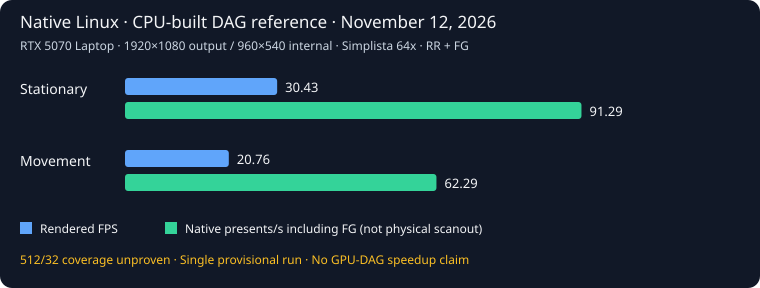

# Native Linux Performance

Minecraft Java Edition **26.3 runs natively on Linux x86-64 with RTX Remix**.
Wine and Proton are not involved. This page records preliminary measurements
from November 12, 2026, rather than predicting performance for every RTX GPU.

**These measurements precede the full GPU DAG builder.** The reference build
uses a native CPU builder and stores its completed DAG pages on the GPU.
Full GPU construction and GPU-driven near-terrain meshing remain in development.

## Hardware and workload

| Setting | Recorded value |
|---|---|
| GPU | NVIDIA GeForce RTX 5070 Laptop GPU, 8 GiB class / 8,151 MiB reported |
| Driver | NVIDIA 615.78.08 |
| OS | Linux 7.2.10-hardened1-3-hardened |
| System memory | 32 GiB |
| Java | Temurin 25.0.5, maximum heap 4,096 MiB |
| Reported logical processors | 20; CPU model was not recorded in the result |
| Minecraft backend | Vulkan |
| Output / internal rendering | 1,920×1,080 / 960×540 |
| Upscaling | DLSS Ray Reconstruction, actual runtime upscaler value 5 |
| Frame Generation | Enabled, up to two generated frames per rendered frame |
| Resource pack | Simplista 64x R36, actual ResourceManager load verified |
| Render / simulation distance | 32 / 8 chunks |
| Requested far terrain | DAG distance 512, native radius 32, cut 1, width 2,048 |
| Reference far-terrain workers/cache | Two LOD workers, two build workers, requested cache 256 MiB |
| Cluster acceleration structures | Off; ordinary KHR path |
| World | Normal NoiseOverworld, seed 976276056 |
| Cold buildup / movement | 240-second buildup; 544 blocks outward and back with rotation |

No unrelated game, compute or video GPU workload was observed in the recorded
process inventories. Desktop display/compositor services remained running.
Global VRAM and GPU-utilization samples therefore are not isolated game,
texture-upload or acceleration-structure allocation measurements.

## CPU-built DAG reference

Run `perf512-20261112-112052` used mod commit
[`ad84df0`](https://github.com/SimonVitzethum/rtx-remix-minecraft-Linux/commit/ad84df05d4c1c6fb686bbb9d6b88385b1da8796b)
and runtime commit
[`9e32460`](https://github.com/SimonVitzethum/rtx-remix-minecraft-Linux/commit/9e324608d17e85409b2179737d489ffd2b24aa1e).

| Phase | Frames | Counter interval | Rendered FPS | Native presents/s including FG | Render-span p50 | p95 | p99 | Maximum |
|---|---:|---:|---:|---:|---:|---:|---:|---:|
| Stationary | 6,000 | 197.04 s | 30.43 | 91.29 | 29.63 ms | 67.02 ms | 78.21 ms | 128.86 ms |
| Movement | 3,601 | 171.99 s | 20.76 | 62.29 | 45.46 ms | 88.52 ms | 126.51 ms | 255.74 ms |

The full camera path completed and Java exited normally with code 0. Scope
memory peaked at approximately 9.00 GiB; sampled global VRAM peaked at 5,436 MiB.
The memory controller recorded 2,799 `high` events and zero `max`, `oom` or
`oom_kill` events. The 9 GiB soft limit still caused memory pressure; these
events are not a measurement of the duration or isolated cause of a stall.

**This is not a 512/32 correctness pass.** Terrain buildup did not converge.
The default distance fade remained 358.4–409.6 blocks, so submitted opaque
pages in ring 31 do not prove visible path-traced pixels across the requested
32-chunk radius. Original image/coverage review remains pending. The JFR export
was missing or unusable, so this run does not support an allocation-profile
conclusion. No claim of a general optimization speedup follows from this run.

## Historical measurements and limits

These runs are retained for transparency, not presented as a matched A/B test.
Reached far-terrain coverage, runtime instrumentation and session completion
differ. All numbers use the same reported output/internal resolution and pack.

| Run | Stationary rendered FPS | Movement rendered FPS | Movement native presents/s including FG | Movement maximum render span | Status |
|---|---:|---:|---:|---:|---|
| `085258`, initial package `5db1caec…` | 36.94 | 16.98 | 50.93 | 7,152.67 ms | Partial; return path aborted, Java exit 143 |
| `112052`, CPU-built DAG reference `6fe3b8d3…` | 30.43 | 20.76 | 62.29 | 255.74 ms | Full frame sequence and Java exit 0; coverage/image review pending |
| `114204`, historical control `2424fb90…` | 34.73 | 28.67 | 86.00 | 270.93 ms | Full frame sequence and Java exit 0; session classified failed because of profiling/export errors |

The initial partial run's movement figures exclude the diagnostic tail.
It had 466,535 memory-controller `high` events, no OOM, and severe native-submit
stalls. A stack inside `RemixBridge.submit` does not isolate their root cause.
Later runs recorded shorter worst spans, but differing achieved coverage and
incomplete profiling prevent attributing that difference to a particular fix.
The historical control also had a higher movement frame rate than the new
reference. Do not advertise a universal speedup from this dataset.

## What the counters mean

- **Rendered FPS** comes from differences of the actual native
  `linuxFrameStats` rendered-frame counter over its recorded time interval.
- **Native presents/s** comes from the actual presented-frame counter and
  includes Frame Generation submissions. It is not a theoretical FPS multiplier
  and does not establish physical display scanout or input latency.
- **Render spans** measure Minecraft's render entry-to-return CPU/wall time.
  Their percentiles are not per-present frame pacing or isolated GPU duration.
- **512/32** describes requested distances. A nonempty DAG, an empty queue or
  submitted mesh/page counts alone do not prove complete terrain or pixel coverage.
- The runs are individual observations. Driver caches may have been warmed by
  earlier attempts; the world began without copied region/player/DAG caches.
  There is no multi-run confidence interval or perfectly cold-driver claim.

## Reproduction and reporting

Build the Linux runtime and mod following [Getting Started](GETTING_STARTED.md#linux).
Use an isolated test instance, the exact world seed and settings above, and no
concurrent GPU workload. Record the actual loaded pack, output/internal size,
resolved runtime settings, source commits, native library hashes and memory
controller events. Keep profiler attachment and diagnostic pauses outside the
recording intervals used for comparison. Wait for the actual Java exit and
restore changed settings.

Retain raw render spans and counter samples. Inspect original framebuffer
captures and actual published coverage before declaring a distance/visual pass.
Repeat stationary and complete outward/return movement phases after terrain
convergence when possible. If buildup does not converge within the bound,
publish that result rather than reporting the requested radius as achieved.

The [JSON measurement extract](benchmarks/linux-2026-11-12.json) includes exact
package/runtime hashes, source-result SHA-256 values, settings, events and
unrounded measurements. The [CSV phase table](benchmarks/linux-2026-11-12.csv)
is suitable for independent plotting. These are sanitized extracts, not the
complete raw frame arrays or a downloadable game/runtime package. No user
account data, private instance paths, worlds or proprietary resource packs
are included.
